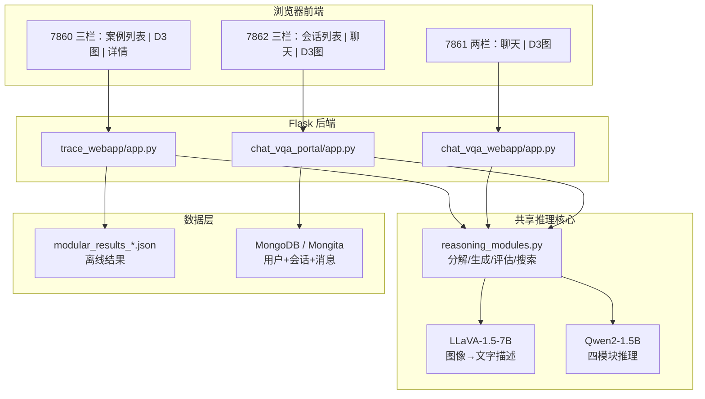

# 三个可视化界面实现说明

本文档说明 `vision_qa_platform` 项目中三个 Web 可视化界面的架构、推理链路与前后端实现方式。

---

## 一、整体架构

三个界面都是 **Flask 后端 + HTML/JS 前端**，由 `webapps_ctl.sh` 统一启动，但职责不同：

| 服务 | 端口 | 定位 |
|------|------|------|
| `trace_webapp` | 7860 | **离线轨迹浏览**：读已跑好的 JSON 结果，看推理过程 |
| `chat_vqa_webapp` | 7861 | **在线问答 Demo**：上传图片即时推理，无登录 |
| `chat_vqa_portal` | 7862 | **完整用户版**：登录、会话历史、MongoDB 持久化 |

### 架构示意



### 启动方式

```bash
cd /root/autodl-tmp/vision_qa_platform/agent_workspace
bash webapps_ctl.sh start    # 启动三个服务
bash webapps_ctl.sh status   # 查看状态
```

在 AutoDL 等云平台访问时，需在本机建立 SSH 端口转发（示例）：

```bash
ssh -p 24484 \
  -L 7860:127.0.0.1:7860 \
  -L 7861:127.0.0.1:7861 \
  -L 7862:127.0.0.1:7862 \
  root@connect.bjb1.seetacloud.com
```

浏览器访问：

- 7860：http://127.0.0.1:7860
- 7861：http://127.0.0.1:7861
- 7862：http://127.0.0.1:7862

---

## 二、共享的「四模块推理」是怎么跑的

7860 / 7861 / 7862 的**在线问答**都走同一套流水线（portal 通过 `vqa_service.py` 复用 webapp 逻辑）。

### 1. 视觉理解（LLaVA）

`VisionToTextReasoner`（`tot_got_integration.py`）用 **LLaVA-1.5-7B** 把图片转成中文视觉描述：

- 模型路径：`llava-1.5-7b-hf`
- 核心方法：`get_visual_description(image_path, question_hint)`
- 流程：PIL 读图 → CLIP 预处理 → LLaVA `generate` → 提取 `ASSISTANT:` 后的中文描述

### 2. 四模块推理（Qwen2-1.5B）

`SearchController.solve()`（`reasoning_modules.py`）串联四个模块：

| 模块 | 类 | 作用 |
|------|-----|------|
| 问题分解器 | `QuestionDecomposer` | 主问题 → 3 个子问题 |
| 思维生成器 | `ThoughtGenerator` | 每个子问题生成 3 条候选（思路 + 答案） |
| 状态评估器 | `StateEvaluator` | 给候选打分（0.1~1.0） |
| 搜索控制器 | `SearchController` | 选最高分候选，汇总成最终答案 |

伪代码流程：

```
sub_questions = decomposer.decompose(visual_description, question)
for sub_q in sub_questions:
    candidates = generator.generate_candidates(...)
    scores = evaluator.score_candidates(...)
    best_idx = argmax(scores)
    trace.append({ sub_question, candidates, scores, selected_index })
final_answer = aggregate(selected_sub_answers)
```

### 3. 答案收敛

`constrained_finalize_answer()`（`vqa_eval_utils.py`）根据视觉描述、原问题和子问题答案，生成最终短答案。

### 4. 模型单例 + 线程锁

三个服务都用 `_PIPELINE` 全局变量 + `threading.Lock()`，**首次请求时加载模型**，之后复用，避免重复占 GPU。

涉及模型：

- 视觉：`/root/autodl-tmp/vision_qa_platform/llava-1.5-7b-hf`
- 语言：`/root/autodl-tmp/vision_qa_platform/text_model/qwen2_1_5b_instruct`

---

## 三、7860：`trace_webapp` — 离线轨迹浏览

**核心思路**：主要读**已经跑好的评测 JSON**，把 `trace` 字段画成图；也支持上传新图做在线推理。

### 代码位置

- 后端：`agent_workspace/trace_webapp/app.py`
- 前端：`agent_workspace/trace_webapp/templates/index.html`（单文件，内联 CSS/JS）

### 数据来源

默认读：

```
/root/autodl-tmp/vision_qa_platform/results/accuracy/modular_results_complex1000.json
```

可通过环境变量 `TRACE_RESULTS_FILE` 切换。

### 后端 API

| 接口 | 作用 |
|------|------|
| `GET /` | 渲染主页面 |
| `GET /api/cases` | 列出所有样本（问题、预测、真值、对错） |
| `GET /api/case/<qid>` | 单个样本的图结构 + 图片 URL |
| `GET /api/case/<qid>/image` | 返回样本图片 |
| `POST /api/ask` | 上传新图 + 问题，在线跑四模块 |

### 图结构怎么构建

`build_graph()` 把 JSON 里的 `trace` 转成 D3 用的 `nodes` + `links`：

```
问题节点
  ├─ 子问题1 ─ 候选1 / 候选2 / 候选3（选中项高亮）
  ├─ 子问题2 ─ ...
  └─ 子问题3 ─ ...
  ├─ 预测节点
  └─ 真值节点（仅离线数据有）
```

节点类型：`question` / `subq` / `candidate` / `candidate_selected` / `pred` / `gt`，前端用不同颜色区分。

### 前端布局（三栏）

| 左栏 | 中栏 | 右栏 |
|------|------|------|
| 案例列表 + 下拉选择 | D3 力导向图（可拖拽、点击看详情） | 节点详情 + 新图片问答表单 |

**特点**：侧重**论文/实验复盘**——能对比预测与真值，看每条轨迹里哪个候选被选中。

---

## 四、7861：`chat_vqa_webapp` — 在线问答 Demo

**核心思路**：聊天式交互 + 右侧实时推理图，**无用户系统**，适合快速演示。

### 代码位置

- 后端：`agent_workspace/chat_vqa_webapp/app.py`
- 前端：`agent_workspace/chat_vqa_webapp/templates/index.html`

### 与 7860 的差异

| 对比项 | 7860 trace | 7861 chat |
|--------|-----------|-----------|
| 主要用途 | 浏览历史结果 | 实时问答 |
| 登录 | 无 | 无 |
| 数据持久化 | 无（刷新即丢） | 无 |
| 中文化 | 轨迹多为英文原文 | **全链路中文化** |
| 布局 | 三栏（含案例列表） | 两栏（聊天 + 图） |

### 中文化处理（7861 独有）

`chat_vqa_webapp/app.py` 在推理后做大量翻译：

- `to_chinese_text()`：问题、视觉描述
- `to_chinese_answer()`：短答案（yes/no → 是/否 等规则映射 + LLM）
- `localize_trace_to_chinese()`：子问题、候选思路、候选答案批量翻译
- `_TRANSLATION_CACHE`：避免重复翻译

### 请求流程

```
用户上传图片 + 问题
    → POST /api/ask
    → LLaVA 描述图像
    → 四模块推理
    → 中文化
    → 返回 { answer, graph, trace, image_url }
    → 左侧聊天气泡 + 右侧 D3 图
```

### 后端 API

| 接口 | 作用 |
|------|------|
| `GET /` | 主页面 |
| `GET /api/health` | 健康检查 |
| `POST /api/ask` | 上传图片 + 问题，返回答案与推理图 |
| `GET /uploads/<filename>` | 访问上传的图片 |

---

## 五、7862：`chat_vqa_portal` — 完整用户版

**核心思路**：在 7861 的推理能力上，加上**账号、会话、历史记录**，做成可用的产品形态。

### 代码位置

| 文件 | 职责 |
|------|------|
| `chat_vqa_portal/app.py` | 路由、Session、权限 |
| `chat_vqa_portal/auth_utils.py` | 注册校验、密码哈希 |
| `chat_vqa_portal/db.py` | MongoDB 文档库（连不上则降级 Mongita 本地 JSON） |
| `chat_vqa_portal/vqa_service.py` | 与 7861 相同的四模块推理 + 中文化 |
| `chat_vqa_portal/templates/` | login / register / chat 页面 |
| `chat_vqa_portal/static/` | CSS、JS（`chat.js`） |

### 数据库设计

默认尝试连接 `mongodb://127.0.0.1:27017`，库名 `vision_qa_portal`；若 MongoDB 未启动，数据写入 `mongo_data/`（Mongita）。

三个集合：

| 集合 | 存什么 |
|------|--------|
| `users` | username, email, password_hash, created_at |
| `conversations` | user_id, title, created_at, updated_at |
| `messages` | conversation_id, role, content, image_path, answer, **graph**, trace, visual_description |

问答时会把 **推理图 `graph` 一并入库**，刷新后还能点开历史消息看 D3 图。

### 认证流程

- Flask `session` + `secret_key`（环境变量 `PORTAL_SECRET_KEY`）
- `@login_required` 装饰器：未登录访问 `/api/*` 返回 401，页面跳转 `/login`
- 注册：`POST /api/auth/register`
- 登录：支持用户名或邮箱，`POST /api/auth/login`
- 退出：`POST /api/auth/logout`

### 会话 API

| 接口 | 作用 |
|------|------|
| `GET /api/conversations` | 左侧会话列表 |
| `POST /api/conversations` | 新建对话 |
| `GET /api/conversations/<id>/messages` | 加载历史消息 |
| `POST /api/conversations/<id>/ask` | 上传图+问题，推理并入库 |
| `DELETE /api/conversations/<id>` | 删除对话 |
| `GET /api/auth/me` | 当前用户信息 |

### 前端布局（GPT 风格三栏）

| 左栏 | 中栏 | 右栏 |
|------|------|------|
| 会话列表 + 新对话 + 退出 | 消息区 + 输入框 | D3 推理图 + 节点详情 |

`chat.js` 主要逻辑：

1. 启动时 `loadConversations()` 拉会话列表
2. 点会话 → 加载历史消息，助手消息带 `graph` 可点击
3. 发送 → `FormData` 上传图片 → `/api/conversations/<id>/ask`
4. 返回后追加气泡 + `renderGraph()`

图片按用户隔离：`uploads/<user_id>/<filename>`，访问时校验 `user_id == session`。

### 环境变量

| 变量 | 说明 | 默认 |
|------|------|------|
| `PORTAL_PORT` | 服务端口 | `7862` |
| `MONGO_URI` | MongoDB 连接串 | `mongodb://127.0.0.1:27017` |
| `PORTAL_SECRET_KEY` | Flask 会话密钥 | 开发用默认值（生产请修改） |

---

## 六、D3 推理图（三个界面共用思路）

三个前端都用 **D3.js v7 力导向图**（CDN：`https://cdn.jsdelivr.net/npm/d3@7`）。

### 共同渲染模式

```javascript
nodes = [{ id, label, type, detail }, ...]
links = [{ source, target }, ...]

d3.forceSimulation(nodes)
  .force("link", d3.forceLink(links).id(d => d.id))
  .force("charge", d3.forceManyBody())      // 节点互斥
  .force("center", d3.forceCenter(...))      // 居中
  .force("collision", d3.forceCollide())    // 防重叠（7860/7861）

// 圆点 + 文字标签 + 拖拽 + 点击显示 detail JSON
```

### 节点颜色映射

| 类型 | 颜色 | 含义 |
|------|------|------|
| `question` | 青色 `#22d3ee` | 主问题 |
| `subq` | 橙色 `#f59e0b` | 子问题 |
| `candidate` | 蓝色 `#60a5fa` | 未选中候选 |
| `candidate_selected` | 绿色 `#34d399` | 选中候选 |
| `pred` | 紫色 `#a78bfa` | 最终答案 |
| `gt` | 红色 `#f43f5e` | 真值（仅 7860 离线） |

### 交互

- **拖拽**：`d3.drag()` 固定节点位置
- **点击节点**：右侧面板显示 `detail` 字段 JSON（子问题文本、候选思路、评分等）

---

## 七、三者关系总结

```
                    ┌─────────────────────────────────────┐
                    │     共享：LLaVA + Qwen 四模块推理      │
                    └─────────────────────────────────────┘
                                      │
        ┌─────────────────────────────┼─────────────────────────────┐
        ▼                             ▼                             ▼
   trace_webapp                  chat_vqa_webapp              chat_vqa_portal
   (7860)                        (7861)                       (7862)
        │                             │                             │
   读离线 JSON                   实时问答                      实时问答
   + 可选在线推理                 无状态                        + 登录
   三栏：案例/图/详情              两栏：聊天/图                  + MongoDB 历史
   适合：实验分析                 适合：快速演示                 三栏：会话/聊天/图
                                                              适合：产品演示
```

**一句话概括**：

- **7860** = 看「已经跑出来的」推理轨迹，像实验报告浏览器
- **7861** = 即时问一张图，像无登录的 ChatGPT + 推理图
- **7862** = 在 7861 基础上加了账号、多轮对话、历史回放，像完整产品

---

## 八、相关文件索引

| 路径 | 说明 |
|------|------|
| `agent_workspace/webapps_ctl.sh` | 三服务启停脚本 |
| `agent_workspace/trace_webapp/app.py` | 7860 后端 |
| `agent_workspace/chat_vqa_webapp/app.py` | 7861 后端 |
| `agent_workspace/chat_vqa_portal/app.py` | 7862 后端 |
| `reasoning_modules.py` | 四模块推理 |
| `tot_got_integration.py` | LLaVA + Qwen 封装 |
| `vqa_eval_utils.py` | 答案收敛与评测工具 |
| `results/accuracy/modular_results_complex1000.json` | 7860 默认离线数据 |

---

*文档生成日期：2026-05-29*
