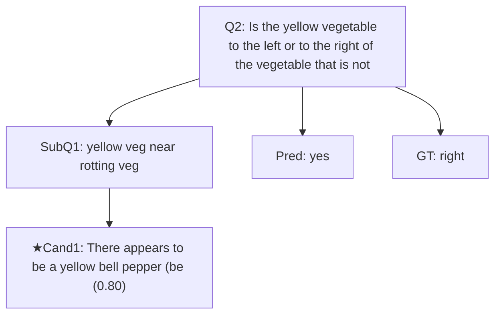
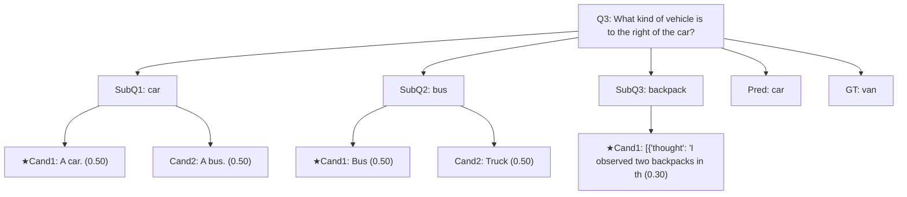
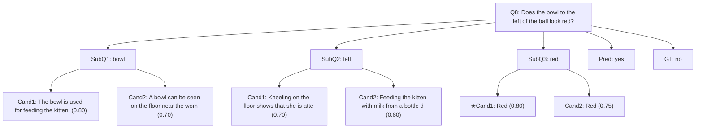
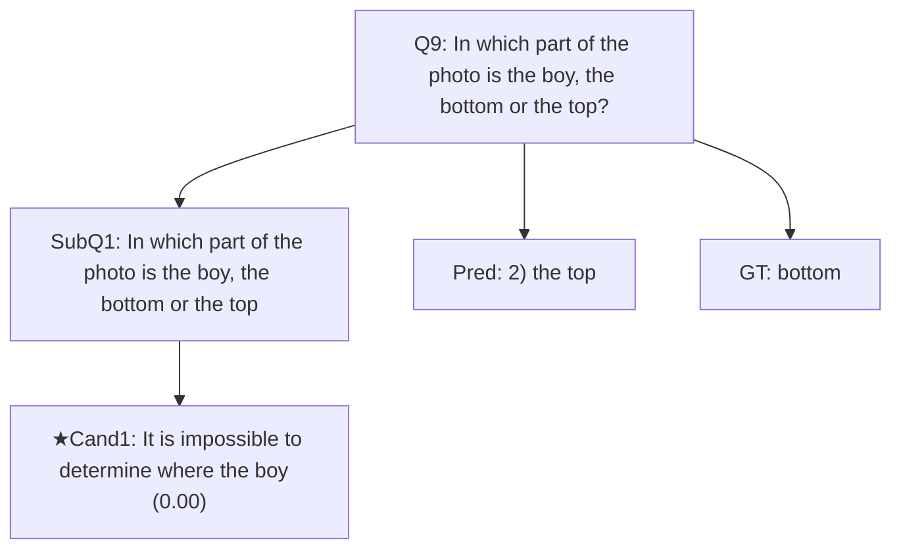
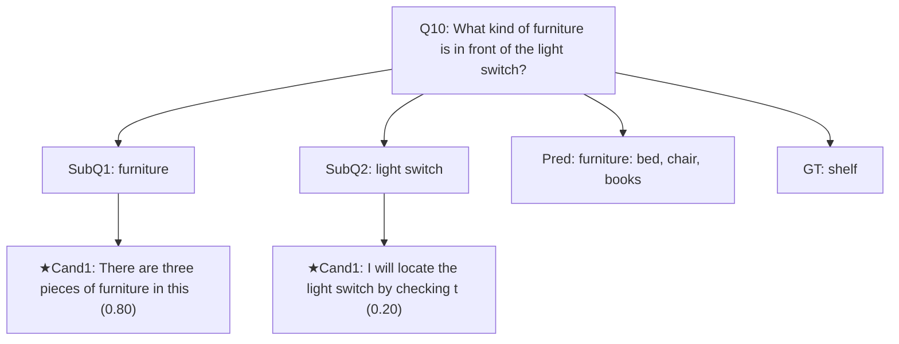

# Figure 4: 思维树/图可视化案例（complex50）

## Case 1 | QID=2
- Question: Is the yellow vegetable to the left or to the right of the vegetable that is not rotten?
- GT: `right` | Pred: `yes` | Correct: `False`



## Case 2 | QID=3
- Question: What kind of vehicle is to the right of the car?
- GT: `van` | Pred: `car` | Correct: `False`



## Case 3 | QID=5
- Question: What is the color of the helmet in the top?
- GT: `gray` | Pred: `white helmet` | Correct: `False`

```mermaid
graph TD
Q["Q5: What is the color of the helmet in the top?"]
S0["SubQ1: What is the color of the helmet in the top?"]
Q --> S0
C0_0["★Cand1: [{\"thought\": \"The question does not speci (1.00)"]
S0 --> C0_0
P["Pred: white helmet"]
G["GT: gray"]
Q --> P
Q --> G
```

## Case 4 | QID=6
- Question: What animal are the trees behind of?
- GT: `elephant` | Pred: `elephants` | Correct: `False`

```mermaid
graph TD
Q["Q6: What animal are the trees behind of?"]
S0["SubQ1: animal"]
Q --> S0
C0_0["Cand1: Elephants (0.80)"]
S0 --> C0_0
C0_1["★Cand2: Zoos / Wildlife Reserves (0.90)"]
S0 --> C0_1
S1["SubQ2: behind the trees"]
Q --> S1
C1_0["★Cand1: [{\"thought\": \"The elephant's feet are vis (0.60)"]
S1 --> C1_0
S2["SubQ3: the type of trees"]
Q --> S2
C2_0["★Cand1: I'm unable to provide an accurate answer as  (0.10)"]
S2 --> C2_0
P["Pred: elephants"]
G["GT: elephant"]
Q --> P
Q --> G
```

## Case 5 | QID=7
- Question: What animal are these, zebras or lambs?
- GT: `zebras` | Pred: `are these, zebras` | Correct: `False`

```mermaid
graph TD
Q["Q7: What animal are these, zebras or lambs?"]
S0["SubQ1: zebra"]
Q --> S0
C0_0["★Cand1: [{\"thought\": \"Zebras are known for their  (0.50)"]
S0 --> C0_0
S1["SubQ2: baby"]
Q --> S1
C1_0["★Cand1: {
    \"thoughts\":[
        \"The baby zebr (0.90)"]
S1 --> C1_0
S2["SubQ3: grass"]
Q --> S2
C2_0["★Cand1: Grass (0.80)"]
S2 --> C2_0
P["Pred: are these, zebras"]
G["GT: zebras"]
Q --> P
Q --> G
```

## Case 6 | QID=8
- Question: Does the bowl to the left of the ball look red?
- GT: `no` | Pred: `yes` | Correct: `False`



## Case 7 | QID=9
- Question: In which part of the photo is the boy, the bottom or the top?
- GT: `bottom` | Pred: `2) the top` | Correct: `False`



## Case 8 | QID=10
- Question: What kind of furniture is in front of the light switch?
- GT: `shelf` | Pred: `furniture: bed, chair, books` | Correct: `False`


