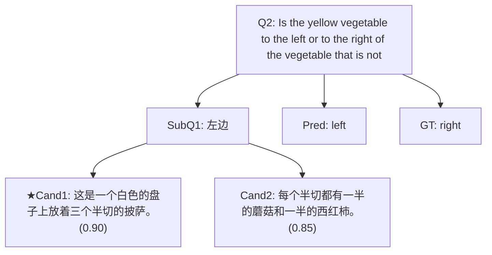
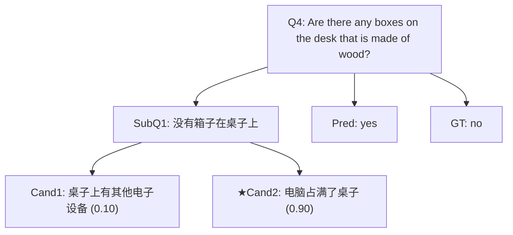
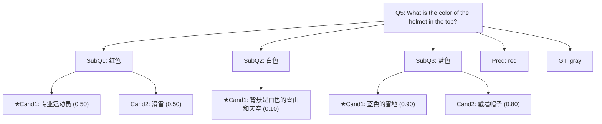
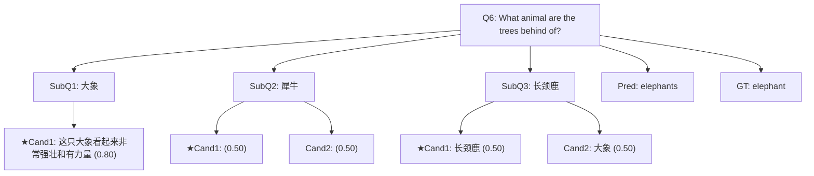
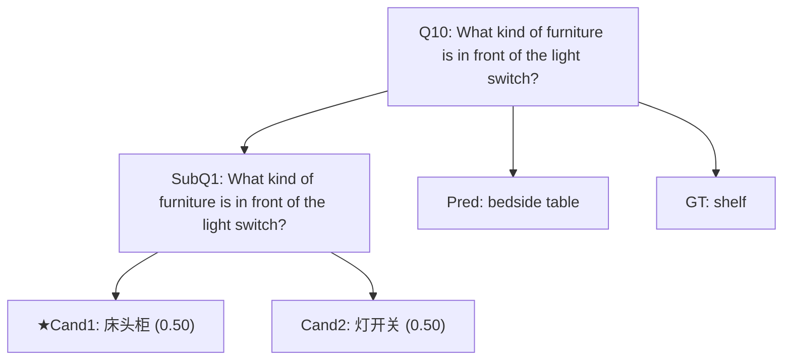
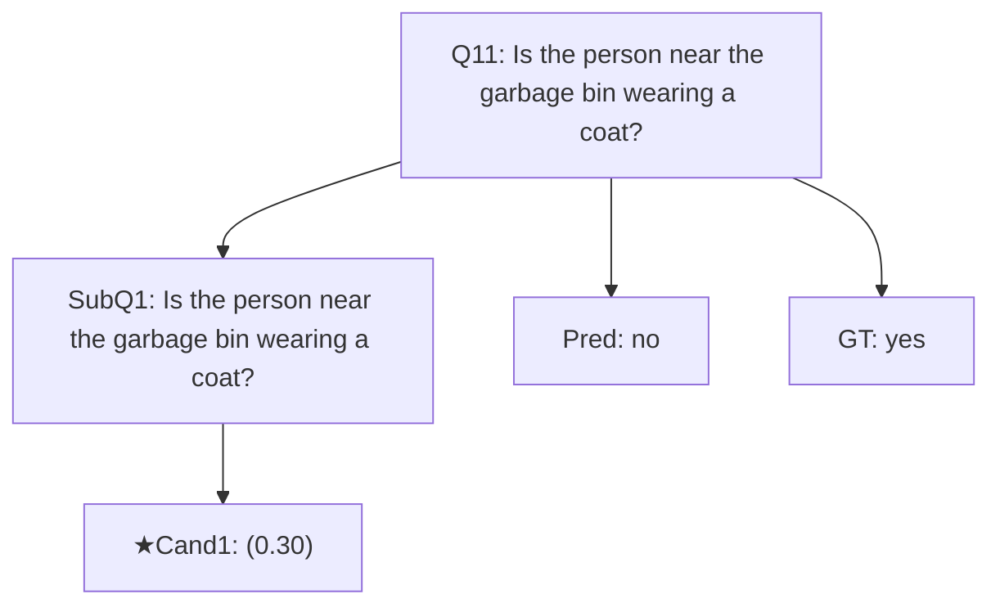

# Figure 4: 思维树/图可视化案例（complex50）

## Case 1 | QID=2
- Question: Is the yellow vegetable to the left or to the right of the vegetable that is not rotten?
- GT: `right` | Pred: `left` | Correct: `False`



## Case 2 | QID=3
- Question: What kind of vehicle is to the right of the car?
- GT: `van` | Pred: `moto bike` | Correct: `False`

```mermaid
graph TD
Q["Q3: What kind of vehicle is to the right of the car?"]
S0["SubQ1: 摩托车"]
Q --> S0
C0_0["★Cand1: [
    {\"thought\":\"这是一辆摩托车，它位于一条繁忙的街道上。\", (0.50)"]
S0 --> C0_0
S1["SubQ2: 繁忙的街道"]
Q --> S1
C1_0["Cand1: 繁忙的街道是指有大量交通流量、车流和人群聚集的地方。 (0.50)"]
S1 --> C1_0
C1_1["Cand2: 繁忙的街道可能位于城市中心或商业区附近，因为这里有较多的交通工具和行人。 (0.80)"]
S1 --> C1_1
S2["SubQ3: 行人"]
Q --> S2
C2_0["★Cand1: 行人可能因为看到骑手的笑容而感到开心或好奇。 (0.50)"]
S2 --> C2_0
C2_1["Cand2: 这条街道上的其他车辆可能会给骑手带来安全感或者视觉刺激。 (0.50)"]
S2 --> C2_1
P["Pred: moto bike"]
G["GT: van"]
Q --> P
Q --> G
```

## Case 3 | QID=4
- Question: Are there any boxes on the desk that is made of wood?
- GT: `no` | Pred: `yes` | Correct: `False`



## Case 4 | QID=5
- Question: What is the color of the helmet in the top?
- GT: `gray` | Pred: `red` | Correct: `False`



## Case 5 | QID=6
- Question: What animal are the trees behind of?
- GT: `elephant` | Pred: `elephants` | Correct: `False`



## Case 6 | QID=9
- Question: In which part of the photo is the boy, the bottom or the top?
- GT: `bottom` | Pred: `top` | Correct: `False`

```mermaid
graph TD
Q["Q9: In which part of the photo is the boy, the bottom or the top?"]
S0["SubQ1: In which part of the photo is the boy, the bottom or the top"]
Q --> S0
C0_0["★Cand1: [{\"thought\": \"男孩可能位于照片的顶部或底部，因为照片中没有其他明显的 (0.10)"]
S0 --> C0_0
P["Pred: top"]
G["GT: bottom"]
Q --> P
Q --> G
```

## Case 7 | QID=10
- Question: What kind of furniture is in front of the light switch?
- GT: `shelf` | Pred: `bedside table` | Correct: `False`



## Case 8 | QID=11
- Question: Is the person near the garbage bin wearing a coat?
- GT: `yes` | Pred: `no` | Correct: `False`


